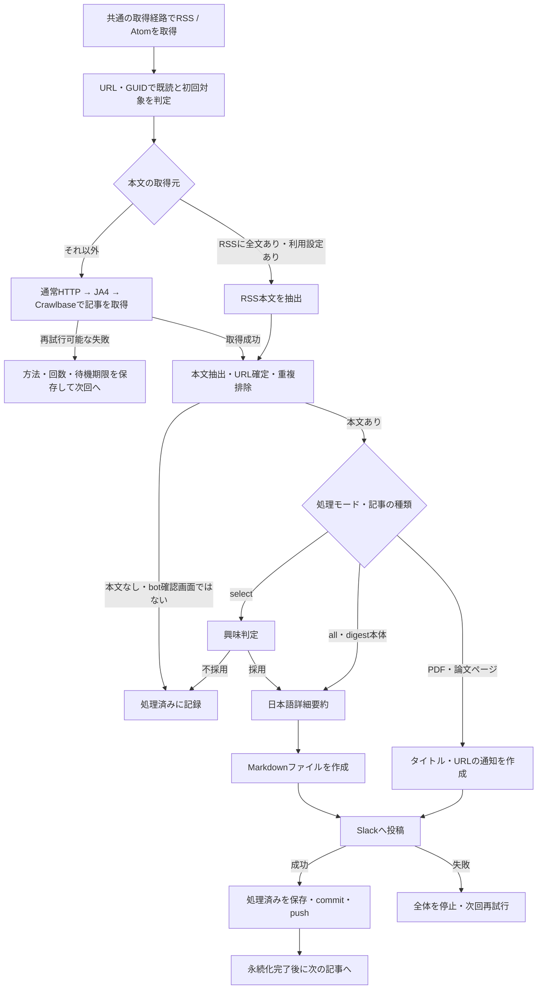

# rss-curator

技術系RSSの新着記事から、深く読んでおきたい記事を選び、技術的な内容を日本語で理解できる形にしてSlackへ届ける個人用ツールです。

追いかけたい情報源が増えると、記事の発見と選別だけでも時間がかかります。rss-curatorはその部分を自動化し、実装の仕組み、設計判断、測定結果、制約まで読める要約を手元に残すことを目指しています。

## 届けたいもの

重視するのは、記事から得られる技術的な学びです。既に関心のある分野との一致に加え、知らなかった技術や設計上の工夫を学べそうな記事も選びます。興味判定の基準はプロンプトで設定します。

要約には、API名や関数名、プロトコルの動作、アルゴリズム、処理フロー、設計の理由、ベンチマークの条件と数値、トレードオフを残します。宣伝や冗長な導入は圧縮し、技術的な説明に紙幅を使います。長い記事は本文を分けて処理し、各部分の詳細要約を1つのファイルにまとめます。

Slackには1記事につき1つのMarkdownファイルを投稿します。長文を複数のメッセージに分割せず、タイトルと原文URLを添えて、あとから記事単位で読み返せる形にします。原文にない情報は補わず、画像を解釈していない場合は図の内容を推測しません。

## 実装に必要な処理

RSSを定期的に読み、AIで要約するだけでは、取得できない記事の取りこぼしや配信の重複が発生します。このアプリケーションでは、記事の発見、本文取得、AI処理、外部への配信、それぞれの進捗を管理します。



図の取得順序は新規の記事に対するものです。`skip_http: true`のフィードはRSS・記事ともJA4から始め、再試行中の記事は保存された取得方法から再開します。OpenAIの日本語版は、本文の存在確認後にRSS情報で興味判定し、採用時は要約せずURLだけを投稿します。`digest`は本体に加えて紹介先も処理します。

### 1. 発見と処理対象の決定

RSS / Atomは記事を発見する入口です。公開日時だけをカーソルにすると、古い日付で追加された記事を見落とすため、記事URLとフィード内のGUIDを識別子として照合します。同じ実行内での重複と、過去の実行での処理済みを両方確認します。

初回は大量の過去記事を配信しないよう各フィードの最新2記事だけを対象にし、それより古い記事は対象外として記録します。2回目以降はフィード内の未処理記事を対象にします。記事の発見元はRSS / Atomに限定し、`digest`の紹介先だけ本文内のリンクから発見します。サイト全体を巡回するクローラーや、RSSから消えた記事を保持する永続キューは実装していません。

#### RSS / Atomを堅牢に扱う

配信元ごとにRSSのバージョン、Atom、名前空間、日付表現、本文の格納先が異なります。XMLを独自の固定構造で読み取るのではなく、この実装では`github.com/mmcdole/gofeed`を使い、共通のフィード・記事モデルへ変換します。パーサーに形式差の吸収を任せたうえで、アプリケーション側でも欠損・重複・失敗を扱います。

| 起こり得ること | この実装の扱い |
| --- | --- |
| RSS / Atomや名前空間、日付形式の違い | `gofeed`で解析し、公開日時・更新日時・本文などを共通のフィールドから参照する |
| 公開日時がない・日時順に並んでいない | 公開日時、なければ更新日時で安定ソートする。両方なければ日時なしとして扱い、日時なし同士の掲載順を保つ |
| GUIDがない・他のフィードと同じGUIDがある | 正規化URLも識別に使い、GUIDはフィードURLと組み合わせてハッシュ化する |
| 同じ記事が複数回掲載される・後から古い日付の記事が加わる | URL・GUIDと保存済み状態で判定し、最終取得日時だけで足切りしない |
| 記事URLが不正・識別子が欠けている | URLを検証し、URL・GUIDとも使えない項目は記録してスキップする。GUIDだけでは本文取得先を復元できない |
| RSSのURLが転送される・サイトがUAを制限する | 転送を追従し、通常HTTP → JA4 → Crawlbaseの順に取得する。`skip_http: true`ならJA4から開始 |
| タイムアウト・非200応答・壊れたXML・過大なレスポンス | 代替取得も試し、最終的に取得・解析できなければそのフィードを中止して他を続行する。429と401・404・410・451ではその場の代替取得を止める。取得失敗だけで初期化済みや既読にしない |
| 本文ではなく短い紹介文だけが入っている | 本文フィールドと概要を区別し、全文のないフィードでは記事ページを取得する |

RSSの堅牢性は「XMLを解析できること」だけではありません。1つのフィードの障害を他へ波及させず、処理済み状態を壊さず、次の定期実行で再確認できることまで含めます。

RSSも同じ実行内で通常HTTP → JA4 → Crawlbaseへフォールバックし、各経路の取得・解析を試します。`skip_http: true`ならJA4から開始し、dry-runではCrawlbaseを省略します。通常実行では429の待機期限を`host_retry_after`、Crawlbase APIの待機期限を`crawlbase_retry_after`へ保存し、期限前の取得を抑止します。RSSには記事ごとの取得方法・失敗回数に相当する状態を持たせず、次回は初期経路から確認します。

ETag / Last-Modifiedによる条件付き取得や壊れたXMLの独自修復は実装していません。`gofeed`を使っても、すべての不正なフィードを読み取れるわけではありません。

### 2. 本文の取得元と内容の検証

RSSの紹介文と記事全文を区別します。`description`の短い抜粋だけを要約すると、設計理由や測定条件などを拾えません。`feed_content: true`のフィードでは、空でない`content:encoded`の本文を使います。それ以外は記事ページを取得します。RSS本文も記事ページと同じ本文抽出処理へ渡します。

| 情報源・形式 | 本文の取り方 | 実装上の判断 |
| --- | --- | --- |
| Netflix TechBlog | RSSに含まれる全文 | 記事ページが403でも、RSS本文から選別・要約できる |
| 通常のHTML記事 | 記事ページのHEAD / GET | リダイレクト先とContent-Typeを確認し、本文を抽出する |
| OpenAI | 日本語版を確認し、利用できなければ英語版の本文を取得 | RSSには短い紹介文しかなく、Netflixと同じ方法では全文を取得できない |
| PDF・論文メタデータのあるページ | タイトルとURLを通知 | PDF本文の取得・解析やAIへの送信を省略する |

各取得経路のHTTPクライアントには90秒のタイムアウトを設定し、RSSは10MiB、HTML本文は20MiBを上限に読み込みます。HTTP 200のbot確認画面は代替取得の対象とし、通常ページから本文を抽出できない場合は本文なしとしてスキップします。HTMLから見出し、コード、表、リンクなどを残したMarkdownを作り、相対URLを絶対URLへ解決します。

#### Readabilityで記事本文を抽出する

HTML全体をそのままAIへ渡すと、ナビゲーション、関連記事、広告、フッターなどが選別・要約に混ざり、入力も大きくなります。単にHTMLタグを除去する方法では、コード、見出し、表、リンクの構造も失われます。そのため、この実装では`github.com/mackee/go-readability`を使って記事本文を抽出し、その結果をMarkdownへ変換します。

`article.go`では次の順序で処理します。

1. `golang.org/x/net/html`でHTMLを解析し、bot確認画面かを判定してから最終URLとcanonical、論文メタデータを確認する。
2. リンクと画像の相対URLを絶対URLへ変換する。
3. 論文ページ以外では`readability.Extract`で本文を抽出する。本文DOMが得られなければ`article_fallback.go`で明示された本文領域から補助抽出する。
4. 抽出したDOMから`readability.ToHTML`と`readability.ToMarkdown`を生成する。HTMLは紹介先リンクの抽出、MarkdownはAIへの入力に使う。
5. 記事ページの補助抽出でも本文がない、またはMarkdownが空の場合は`no_article_content`としてスキップし、代替取得・AI処理・失敗通知を追加で行わない。RSSに含まれる本文の抽出失敗はエラーにし、記事ページには切り替えない。

通常HTTP、JA4、Crawlbase、RSSに含まれる本文のいずれも、この共通の抽出処理へ渡します。取得経路ごとに抽出品質やURLの扱いが変わらないようにします。

Readabilityの抽出は推定なので、サイトによって本文の欠落や周辺情報の混入は起こり得ます。JavaScriptの実行や、画像そのものの理解も行いません。新しい情報源を追加するときは、代表的なHTMLをfixtureにして、必要な見出し・コード・表・リンクが残り、不要な周辺要素を拾っていないか確認します。HTTPの成功と、要約に使える本文の取得成功は分けて検証する必要があります。

記事のURLはリダイレクト後のURLとcanonical宣言から確定し、もう一度重複を確認します。詳細なURLの採用条件は[初回と重複の扱い](#初回と重複の扱い)を参照してください。

### 3. 選別と要約

`select`は本文で興味判定してから採用記事だけを要約し、`all`と`digest`の本体は判定を省略します。AIへの入力では記事を信頼できないデータとして扱い、記事内の指示を実行しないよう指定します。採否だけでなく、応答の型やスコアが妥当かも検証し、拒否・不正応答を不採用として確定しません。

長い本文は48,000バイトを目安にUTF-8文字の境界を保って分割し、部分ごとに要約して1記事のファイルへまとめます。全体を再度要約して圧縮する方式ではありません。AI呼び出しは1要求5分を上限にし、SDK内部の自動再試行を無効にして、失敗した記事を次回実行へ残します。

### 4. 配信と処理確定

「要約の生成完了」と「読者への配信完了」は別の状態です。通知対象の記事を処理済みにするのはSlackへの投稿成功後です。不採用・本文なしの記事は投稿せず処理済みにします。取得を断念した記事も自動再試行を止めるため処理済みにしますが、取得失敗通知の配信待ちは別に保持します。

1記事ずつ「生成 → 投稿 → 状態保存 → commit / push → 次の記事」の順に進めます。投稿や永続化の失敗時は全体を止め、後続記事のAI処理を進めません。Slack投稿とGit更新には共通のトランザクションがないため、投稿成功直後の中断による重複配信は残ります。厳密な1回限りの配信は保証しません。

### 5. 再試行・利用上限・運用

失敗と待機を区別し、取得方法、連続失敗回数、次回試行日時を実行間で保存します。403・bot確認画面・通信障害では同じ実行内で次の取得方法へ切り替えます。本文を抽出できない通常ページはスキップします。429はホスト単位で待機し、期限後に次の方法を試します。トークン未設定、利用上限、待機中による保留は失敗回数に加えません。恒久エラーや上限到達では停止して通知します。判定の詳細は[RSS・記事の取得とフォールバック](#rss記事の取得とフォールバック)にまとめています。

同じ状態を複数の実行が更新しないようActionsを直列化します。dry-runではRSSの候補確認だけを行い、AI・配信・状態更新を省略します。公開ログには調査に必要な失敗分類と回数を残し、トークン、本文、要約、個人用プロンプトを出しません。

## 情報源と処理モード

`feeds.json`で情報源と処理モードを管理します。初期設定にはCloudflare、Meta Engineering、Go Blog、Feisty Duck、GFW Report、research!rsc、OpenAIなどを登録しています。実際の一覧は`feeds.json`を参照してください。

| モード | 読み方 |
| --- | --- |
| `select` | 通常の情報源向け。本文を読んで興味を判定し、採用記事を詳細要約する |
| `all` | すべて読みたい情報源向け。興味判定を省略して詳細要約する |
| `digest` | Feisty Duck向け。本体を必ず要約し、紹介先も個別に選別・要約する |

### 通常HTTPを省略する

通常HTTPで取得できない情報源には、フィード単位で`skip_http: true`を指定します。RSSと記事の取得をJA4から始め、必要に応じてCrawlbaseへフォールバックします。省略・`false`なら通常HTTPから始めます。ホスト名による自動判定はありません。

```json
{
  "name": "情報源の名前",
  "url": "https://example.com/feed.xml",
  "mode": "select",
  "skip_http": true
}
```

設定はそのフィードのRSS、記事、日本語版の確認、`digest`の紹介先に適用し、転送先や紹介先が別ホストでも引き継ぎます。次のフィードには引き継ぎません。RSS本文を利用する場合は、従来どおり記事ページへのアクセス自体を省略します。再試行中の記事がすでにCrawlbaseなどへ移行している場合は保存済みの方法から再開し、停止済み・処理済みの記事は設定変更だけでは再処理しません。

現在の`feeds.json`ではOpenAIのフィードで有効にしています。日本語版を優先する`openai_japanese`とは独立した設定です。

### OpenAIの日本語版

OpenAIは英語版RSS（`https://openai.com/news/rss.xml`）を購読し、専用オプション`openai_japanese: true`で日本語版を優先します。このオプションはOpenAI公式RSSの`select`モードだけで利用できます。省略・`false`なら通常の`select`と同じ動作です。

```json
{
  "name": "OpenAI",
  "url": "https://openai.com/news/rss.xml",
  "mode": "select",
  "openai_japanese": true,
  "skip_http": true
}
```

OpenAIのフィードでは`skip_http: true`を指定し、RSS・記事をJA4 → Crawlbaseの順に取得します。この取得順序はホスト名ではなく設定で決まります。日本語版の確認と投稿方法は従来どおりです。旧設定の`http_workaround`は不要になり、指定しても無視されます。

まず記事URLに`/ja-JP`を付けて取得し、リダイレクト後も同じ日本語パスで、抽出本文に十分な日本語（かな20文字以上、日本語80文字以上、文字の25%以上）があることを確認します。日本語本文があればRSSのタイトル・概要・本文フィールドで興味判定し、採用記事の日本語版URLだけを投稿します。詳細要約は行いません。英語のcanonicalを宣言する日本語ページも、実際の日本語URLを投稿します。日本語版がなければRSS情報で事前に除外せず、英語本文による従来の興味判定・詳細要約を行います。どちらも興味判定APIは1回で、待機中や処理済みの記事は呼び出しません。

日本語版の404等の恒久エラー、英語版へのリダイレクト、日本語本文の不足は英語記事の通常の興味判定・詳細要約へ戻します。取得経路は`skip_http`に従い、有効ならJA4 → Crawlbase、省略・`false`なら通常HTTP → JA4 → Crawlbaseの順に試します。429は期限まで待機します。日本語版に本文がない場合や取得を断念した場合は英語版へ戻します。日本語版の不在自体は取得断念通知や既読扱いにしません。英語版の取得失敗通知は従来どおりです。待機中・Crawlbase未設定や上限到達中は、RSSの興味判定も省略します。

日本語版は詳細要約の代わりにURLだけを、他の記事と同じ`notify_slack`の投稿経路で送ります。Markdownファイルは生成しません。投稿成功後だけ英語・日本語・canonicalの対応を処理済みとして保存します。

### ニュースレターの紹介先と本文解析を省略する記事

`digest`では、リンク周辺の紹介文も興味判定に使います。本体と紹介先は別々のファイルとして届けます。広告、購読、ナビゲーション、共有リンクを除外し、紹介先の記事にあるリンクは追跡しません。紹介先のハッシュ一覧と完了状態を保存し、本体と全紹介先が処理済み（不採用・除外・停止を含む）なら本体を再取得しません。未完了の紹介先がすべて待機中、Crawlbase未設定、利用上限到達などの場合も本体を取得しません。紹介先の再試行が必要な場合だけ、URLを再発見するために本体を取得します。

PDFはタイトルとURLだけを通知します。本文のダウンロード、解析、AIへの送信は行いません。論文メタデータがあるHTMLのランディングページも同じ扱いです。メタデータのない論文ページを完全に識別することはできません。

### 初回と重複の扱い

初回は各フィードの最新2記事だけを対象とし、それより古い記事は対象外として記録します。最新順は公開日時、なければ更新日時を使い、日時がない記事同士はRSSの掲載順を使います。初回の対象記事で処理に失敗したものは、次回の再試行対象に残します。

2回目以降は件数を制限せず、RSS内の未処理記事を取得します。日時だけで既読を判断せず、記事URLとRSSのGUIDも照合するため、古い公開日で追加された記事も対象になります。

複数のフィードやFeisty Duckで同じ記事を見つけても、重複投稿を避けます。記事の識別には、妥当性を確認したcanonical URLを優先し、利用できなければリダイレクト後のURLを使います。フラグメントと明らかな追跡パラメータを除き、記事の識別に必要なクエリは保持します。canonicalが別ホストやトップページを指す場合、複数の宣言が矛盾する場合、`og:url`と一致しない場合は採用しません。同一ホスト上の誤ったcanonicalを完全には判別できません。

## 構成と状態管理

日常の実行はGitHub Actionsで行います。Goが記事の取得と要約を担当し、`scripts/run.sh`が記事ごとのSlack投稿と状態の永続化を担当します。Slack投稿には[notify_slack](https://github.com/catatsuy/notify_slack)を使います。Actionsでは最新ReleaseのLinux向けバイナリを取得して配置します。

ソースコードと設定は`main`、処理状態は`rss-state`ブランチに置きます。個人利用の規模に合わせ、状態はJSONファイルで管理します。

### 実装の責務

| ファイル | 担当する処理 |
| --- | --- |
| `main.go` | CLI引数、終了・キャンセル、GoとShellの投稿確認プロトコル |
| `run.go` | 設定検証、RSS取得・`gofeed`での解析、初回対象、重複排除、記事処理全体の進行 |
| `article.go` | URL正規化、canonical検証、HTML取得・Readabilityによる本文抽出とMarkdown変換、紹介先リンク抽出 |
| `article_fallback.go` | 通常の本文抽出が失敗した場合の、明示された本文領域からの補助抽出 |
| `fetch.go` | 記事の取得経路・再試行、RSSと共用するCrawlbase取得、待機期限、回数制限、停止・スキップ判定 |
| `source_http.go` / `http_workaround.go` | RSSのフォールバック、`skip_http`による開始経路、bot確認画面の判別、ブラウザ型TLS接続 |
| `openai_feed.go` | RSS本文利用の分岐、OpenAI日本語版の確認・URL通知 |
| `ai.go` / `auth.go` | 認証、プロンプト、興味判定、分割要約、APIエラーの秘匿 |
| `state.go` / `digest.go` / `failure_notice.go` | 状態ファイルの保存、紹介先の進捗、取得断念通知 |
| `scripts/run.sh` | Slack投稿、成功応答、状態ブランチへのcommit / push、一時ファイルの後始末 |
| `.github/workflows/rss.yml` | 定期起動、Secrets注入、ビルド、同時実行制御 |
| `.github/workflows/ci.yml` | push・Pull Request時のビルド、オフラインテスト、`go vet` |

GoとShellは標準入出力で連携します。Goが`ready`または`link`を送り、Shellが投稿成功を`posted`で返します。Goは処理済みを保存して`saved`を送り、Shellはcommit / pushの成功後に`continue`を返します。どちらかが失敗した場合は次の記事へ進みません。

### 保存する状態と再実行

| 状態フィールド | 用途と更新タイミング |
| --- | --- |
| `initialized` | フィードを初期化したか。初回対象を決めた時点で保存 |
| `processed` | 配信済み、不採用、初回の対象外、取得停止など、再処理しない識別子と日時 |
| `aliases` | RSSのGUIDや取得前URLなどのハッシュと、確定した記事IDの対応 |
| `fetch` | 取得方法、回数、失敗分類、待機期限、停止理由、失敗通知待ち |
| `host_retry_after` | 対象ホストへの取得を止める期限 |
| `crawlbase_retry_after` | Crawlbase APIへの取得を止める期限 |
| `digests` | ニュースレターから発見した紹介先のハッシュ一覧。完了印は`processed`に保存 |

`processed`だけでは「投稿済み」と「意図的なスキップ」を区別できません。取得の停止理由は`fetch`、配信の失敗は実行ログも確認します。状態ファイルは一時ファイルへ書き、renameで置き換えて、書き込み途中のJSONを残しにくくしています。

### 投稿成功後に処理を確定する

要約ができた時点では、通知対象の記事を処理済みにしません。通常実行ではSlackへの投稿に成功した直後に確定し、状態を永続化してから次の記事へ進みます。手動投稿では`ack`で確定します。興味なしと判定した記事は、通知せず処理済みにします。

Goはフィード初期化時と記事の処理後に状態を保存します。ShellはGoの終了後と各投稿の確定後に状態をcommit / pushし、途中終了時にも保存を試みます。状態保存やpushに失敗した場合はジョブを失敗させます。

SlackとGitの更新は同時には確定できないため、投稿成功から状態保存までの間に中断すると再投稿される場合があります。また、RSSから既に消えた記事は発見・再試行できません。実行間隔の間にRSSの保持件数を超える記事が追加された場合も同様です。

### 公開する情報を絞る

`rss-state`に保存するのは、記事や識別子のSHA-256、処理日時、フィード初期化状態、再確認に必要なハッシュ同士の対応、記事取得の方法・失敗分類・試行回数・次回試行日時・最終試行日時・最終発見日時・失敗通知待ちフラグ、ホストの待機期限、ニュースレターの紹介先ハッシュ一覧と完了状態です。興味判定のスコア・採否・理由、記事URL、要約、個人用プロンプトは保存しません。

投稿用ファイルは一時ディレクトリに生成し、実行終了時に削除します。GitへのcommitやActionsの成果物としての公開は行いません。APIキー、Slack Token、個人用プロンプト、要約全文も公開ログに出しません。

## GitHub Actionsで使う

OpenAIへの認証にはAPIキーを使います。GitHubの **Settings → Secrets and variables → Actions → Secrets** に、`OPENAI_API_KEY`という名前でAPIキーを登録してください。ワークフローはこのSecretを読み込みます。

Workload Identity用のVariablesや`id-token: write`は不要です。以前登録したVariablesが残っていても、APIキーを優先します。

### プロンプトとSlack

プロンプトはリポジトリの次のファイルに含めています。Actionsはcheckoutしたファイルをそのまま読み込むため、プロンプト用のSecret登録やファイル転送は不要です。内容を変更する場合はファイルを編集してcommitしてください。

- `prompts/interest.md`: 記事の興味判定基準
- `prompts/summary.md`: 日本語詳細要約の指示

**Settings → Secrets and variables → Actions → Secrets** に次の2項目を登録します。

| Secret | 内容 |
| --- | --- |
| `NOTIFY_SLACK_TOKEN` | Slack Bot Token |
| `NOTIFY_SLACK_CHANNEL_ID` | 投稿先の非公開チャンネルID |

プロンプトを非公開にしたい場合は、任意で`INTEREST_PROMPT`と`SUMMARY_PROMPT`をSecretsに登録すると、リポジトリのファイルより優先されます。

Slack AppのBot Tokenに`files:write`を付与し、アプリをワークスペースへインストールして非公開チャンネルへ招待してください。投稿先にはチャンネル名ではなく、チャンネル詳細から取得したIDを設定します。

Actionsを有効にし、`GITHUB_TOKEN`による`rss-state`へのpushを許可してください。ワークフローには`contents: write`を設定しています。PATは不要です。ブランチ保護規則でpushが拒否される場合は規則を調整してください。

定期実行の欠落が多いため、1時間おき（毎時37分）に実行します。

手動実行はActionsタブの「RSSの選別とSlack投稿」から **Run workflow** を選びます。`dry_run`を有効にすると対象候補の列挙だけを行います。

## 設定を変える

### RSSの追加

`feeds.json`に次の形式で追加します。

```json
{
  "name": "情報源の名前",
  "url": "https://example.com/feed.xml",
  "mode": "select"
}
```

新しく追加したフィードも、初回は最新2記事から始めます。`digest`はFeisty Duck用です。GFW Reportは`https://gfw.report/index.xml`を`all`モードで登録し、興味判定を省略して処理します。`path_suffix: "/en/"`で英語版の記事だけを対象にし、中国語版との重複を避けます。

### RSSに含まれる本文を使う

Netflix TechBlogでは次の設定を使います。

```json
{
  "name": "Netflix TechBlog",
  "url": "https://netflixtechblog.com/feed",
  "mode": "select",
  "feed_content": true
}
```

`feed_content: true`を指定したフィードでは、RSSの`content:encoded`に含まれる本文を要約に使い、記事ページへのアクセスを省略します。Netflix TechBlogで有効にしています。本文が空の場合は通常の記事取得を行います。`description`の抜粋は本文として使いません。既に処理済み・取得断念になった記事の状態は自動的には解除しません。

RSS本文の抽出に失敗した場合はエラーにし、その場で記事ページの取得へ切り替えません。この経路の抽出失敗は通常HTTP・Crawlbaseの取得失敗カウンターには加算されません。RSSに本文が含まれるか、抜粋だけでないかを確認してから有効にしてください。OpenAIのフィードでは有効にしていません。`openai_japanese`と併用してRSS本文が存在する場合は、RSS本文の利用が優先されます。

### 興味判定と要約

`prompts/interest.md`に選びたい記事の基準、`prompts/summary.md`に要約の指示を記述します。初期プロンプトには個人名や所属を含めていません。これらのファイルはPublicリポジトリで公開される設定です。

`INTEREST_PROMPT_FILE`と`SUMMARY_PROMPT_FILE`で読み込むファイルを変更できます。環境変数`INTEREST_PROMPT`と`SUMMARY_PROMPT`に本文を直接指定した場合は、そちらを優先します。

興味判定にはDecisions API、詳細要約にはResponses APIを使います。モデルと採用基準は次の環境変数で変更できます。

| 環境変数 | 初期値 | 用途 |
| --- | --- | --- |
| `INTEREST_MODEL` | `gpt-6-luna` | 興味判定のモデル |
| `SUMMARY_MODEL` | `gpt-6.1-sol` | 詳細要約のモデル |
| `INTEREST_THRESHOLD` | `1.0` | 採用するスコアの下限 |
| `INTEREST_LEVELS` | 新しい技術的な学びが乏しい／具体的な学びはあるが深さや新規性は限定的／深い技術的知見や重要な発見や実践的な学びがある | 順序付き評価ラベル。カンマ区切りで2〜10段階 |

スコアは0始まりのレベル番号の確率加重平均です。初期設定は0〜2で、1.0以上を採用します。閾値はレベルの範囲内に設定してください。拒否や不正な応答は不採用として確定せず、再試行対象にします。

正常な興味判定は、構造化ログ「興味判定」に記事URL、モデル、`score`、`threshold`、`accepted`を記録します。URLの認証情報・クエリ等は省略します。`all`と`digest`の本体は興味判定を行わないため、このログは出ません。

Actionsでは同名のRepository variablesでモデルと閾値を変更できます。評価ラベルを変える場合は、ワークフローの`env`にも`INTEREST_LEVELS`を追加してください。API使用量は[OpenAI Usage](https://platform.openai.com/usage)でプロジェクト・モデル別に確認できます。

### RSS・記事の取得とフォールバック

新規のRSS・記事は次の順序で取得します。JA4経路はuTLSのChrome 133型ClientHello・HTTP/1.1・ブラウザ系UAを使い、最後の経路には[Crawlbase Crawling API](https://crawlbase.com/docs/crawling-api)を使います。

| フィード設定 | 取得順序 |
| --- | --- |
| `skip_http`省略・`false` | 通常HTTP → JA4 → Crawlbase |
| `skip_http: true` | JA4 → Crawlbase |

拒否応答、bot確認画面、通信障害では同じ実行内で次の経路へ進みます。429・恒久エラー・本文なしの扱いは下表を参照してください。通常取得の成功時に代替取得は行いません。JA4経路はサイトに関係なく利用でき、証明書検証、タイムアウト、リダイレクト制限を維持します。dry-runではRSS取得に通常HTTPとJA4だけを使い、Crawlbaseや記事ページは取得しません。`skip_http: true`ならdry-runでもJA4から始めます。RSSも記事もCrawlbaseの実行内上限を共有します。

HTMLは取得経路に関係なく同じ本文抽出・canonical判定へ渡します。Readabilityが本文を選べない場合は、`main`・`article`・`role="main"`・Drupalの`field--name-body`で明示された本文領域を補助的に利用します。500文字以上の文章があり、リンクが半分以下の領域だけを採用し、ナビゲーション・フッター等を除外します。標準の抽出で本文が周辺要素と一緒に除去される構造にも、この補助抽出で対応します。短いランディングページなど、本文を抽出できない通常ページは`no_article_content`として処理済みにし、その時点で取得を打ち切ります。追加の代替取得・AI呼び出し・取得断念通知は行いません。OpenAI日本語版の確認では本文なしを英語版への切り替え条件とし、日本語版の不在だけでは既読にしません。

HTTP 200でも、[Cloudflare公式の識別ヘッダー](https://developers.cloudflare.com/cloudflare-challenges/challenge-types/challenge-pages/detect-response/)である`cf-mitigated: challenge`があれば`bot_challenge`と判定します。ヘッダーがない場合も、確認画面のタイトルとchallenge用フォーム・スクリプトの両方があるときは次の取得方法へ進みます。本文中にbot対策やCAPTCHAの説明があるだけでは判定しません。識別できる特徴のない独自の確認画面は判別できない場合があります。

Crawlbaseが成功扱い（HTTP 200・`cb_status: 200`）で301/302/303/307/308を返した場合は、転送応答の本文を使わず、`original_header_location`または`url`ヘッダーの転送先をCrawlbaseで再取得します。各要求を実行内の利用回数に数え、循環や10回以上の転送は停止します。利用上限による繰り越しは失敗回数に加えません。転送先URLも認証情報・クエリを除いてログに記録します。

| 環境変数 | 初期値 | 用途 |
| --- | --- | --- |
| `CRAWLBASE_TOKEN` | 未設定 | **Normal Token**。Actionsでは同名のRepository Secretに登録 |
| `CRAWLBASE_MAX_REQUESTS` | `5` | 1実行のCrawlbaseリクエスト上限（失敗も含む）。`0`で停止。Actionsでは同名のRepository variableで変更 |
| `ARTICLE_MAX_FETCH_FAILURES` | `3` | 1記事の連続取得失敗の上限。通常HTTP・JA4・Crawlbaseの一連の取得を1試行として数え、実行間で維持。1以上の整数。Actionsでは同名のRepository variableで変更 |
| `ARTICLE_USER_AGENT` | `rss-curator (+https://github.com/catatsuy/rss-curator)` | 通常HTTPの記事取得（HEAD/GET）で送るUAの上書き。JA4経路はChrome型UAを使う。Actionsでは同名のRepository variableで変更 |

通常HTTPの記事取得UAは`ARTICLE_USER_AGENT`で変更できます。`skip_http: true`のフィードでは通常HTTPを省略し、省略・`false`では通常HTTPから始めます。JA4経路では転送先も含めてブラウザ型TLSとUAを使います。OpenAI API・Crawlbase APIへの通信設定は変更しません。URLの末尾`/`は推測で追加せず、実際の最終URLとcanonicalを重複排除に使います。既に停止・処理済みになった記事を自動的に再試行することはありません。

YouTube（短縮URL・サブドメインを含む）、求人サイト/求人・採用ページ、寄付・購読ページは取得前に除外します。これらには通常HTTP・JA4・Crawlbase・OpenAIのリクエストを送りません。Crawlbaseへの切り替え予定だったURLにも適用します。

JavaScriptレンダリングやJavaScript Tokenへの自動切り替えは行いません。トークン未設定でも通常HTTPの記事は処理できます。Crawlbaseへ切り替え済みの記事は、通常HTTPを再試行せず、トークンの設定まで保留します。上限到達も失敗回数に加えず、残りを次回へ繰り越します。

以下は記事の直接取得（通常HTTP・JA4）の扱いです。RSSも429と401・404・410・451ではその場の代替取得を止め、次回はホスト待機期限を確認して初期経路から再開します。

| 記事の直接取得の結果 | 次の処理 |
| --- | --- |
| 2xxで本文あり | 本文を使って処理を続行 |
| 403 | 同じ実行内で次の経路へ（通常HTTP → JA4、JA4 → Crawlbase） |
| 429 | 最低1時間と`Retry-After`（秒数・HTTP日時）の遅い方まで待ち、次回以降に次の取得方法（JA4またはCrawlbase）。同じホストの別記事も期限までは取得しない |
| 401・404・410・451 | 恒久失敗として自動再試行を停止 |
| 5xx・タイムアウト・接続エラー | 同じ実行内で次の経路へ |
| HTTP 200のbot確認画面 | 同じ実行内で次の経路へ |
| 本文抽出失敗（bot確認画面の特徴なし） | 本文なしとしてスキップ。代替取得や失敗通知は行わない |

5xx・接続障害やbot確認画面から回復できない場合を取得失敗に数えます。通常HTTP → JA4 → Crawlbaseの一連の取得を1試行として数え、既定3回の連続失敗で停止します。次回は保存された取得方法から再開します。各経路のHEAD/GETや途中のフォールバックを個別の失敗には数えず、本文取得の成功で連続失敗回数をリセットします。待機・Crawlbaseの利用上限・トークン未設定による保留は失敗回数に加えません。旧状態ファイルは、保存済みの失敗中の試行回数を新しいカウンターへ引き継ぎます。

`HEAD`が429を返した場合は、その後の`GET`も行いません。待機は長い`sleep`ではなく、状態ファイルの日時で制御します。

CrawlbaseはAPIのHTTPステータス・`cb_status`・`original_status`のすべてを確認します。同期取得でHTTP 200・`cb_status` 200・対象2xxの場合だけ本文を処理します。対象の403・429・401・404・410・451、bot確認画面、Crawlbaseがブロックや空応答と判定した場合などの恒久失敗は停止します。正常に取得した通常ページの本文抽出失敗は、他の経路と同じ本文なしスキップです。Crawlbase側の5xx、接続障害、対象5xx、不正な応答などは最低1時間あけて、**連続3回失敗まで**実行間で再試行します。ただし、記事全体の`ARTICLE_MAX_FETCH_FAILURES`に先に達した場合はそこで停止します。API自体の429は他のCrawlbase取得にも待機期限を適用し、APIの認証・残高エラーではその実行の後続Crawlbase呼び出しも抑止します。

取得状態は記事URLのハッシュをキーに、既存の`rss-state`ブランチの`state.json`へ保存します。待機中の記事は処理済みにしません。停止した記事のハッシュは処理済みとして残し、URLや認証情報は保存しません。新しいフィールドは省略可能で、既存の状態ファイルをそのまま読めます。紹介先一覧のない旧形式の投稿済みニュースレターは、一覧の移行のため最初の1回だけ本体を取得します。全紹介先の完了後は、実行間や取得状態の30日整理後も本体を再取得しません。成功して処理が完了した取得状態、期限が切れたホスト待機、30日間再発見されなかった取得状態は削除します。RSSや紹介元から消えたURLは従来どおり再発見できないため、別の永続キューは作りません。

スケジュール・手動・再実行で同じ状態ブランチを読み、既存の同時実行制御とcommit / pushを使います。Crawlbase取得後にOpenAIやSlackで失敗した場合、本文は永続化しないため、次回の本文取得が再度必要になります。

取得を恒久失敗・試行上限で停止したときは、URL、取得方法、失敗・停止理由、試行回数をSlackに通知します。通常の再試行中、本文なしのスキップ、動画・求人等の意図的な除外は通知しません。既存のシェル側の`notify_slack`と投稿後の状態保存・1秒待機を使い、OpenAIは呼びません。通知失敗時は実行を終了し、通知待ちフラグを状態に残します。次回は記事を再取得せず通知だけを再試行します（digest紹介先のURLを再発見するための本体取得は必要です）。通知成功後は繰り返し通知しません。ただしSlack投稿後の状態保存に失敗した場合は再通知される可能性があります。導入前に停止済みの記事は遡って通知しません。URLのクエリ・認証情報は通知に含めません。

構造化ログには、URL（認証情報を含み得るクエリ等は省略）、取得方法、各ステータス、結果/失敗分類・停止理由、試行回数・連続失敗回数・失敗上限、次回取得方法・待機期限、実行内のCrawlbase回数を出します。Crawlbaseのトークンを含むAPI URL、レスポンス本文、HTTPクライアントの生のエラーは出しません。

## ローカルで使う

`go.mod`に指定されたGoバージョンを用意し、[notify_slackの最新Release](https://github.com/catatsuy/notify_slack/releases/latest)からOS・CPUに対応するバイナリをダウンロードしてPATHへ配置します。

ローカル実行でも`OPENAI_API_KEY`を設定します。dry-runでは認証は不要です。

```bash
go build -o rss-curator .

export OPENAI_API_KEY='...'
# 任意：通常HTTP・JA4の失敗後にCrawlbaseを利用する場合
export CRAWLBASE_TOKEN='...'
export CRAWLBASE_MAX_REQUESTS=5
export INTEREST_PROMPT_FILE="$PWD/prompts/interest.md"
export SUMMARY_PROMPT_FILE="$PWD/prompts/summary.md"
export NOTIFY_SLACK_TOKEN='...'
export NOTIFY_SLACK_CHANNEL_ID='...'

scripts/run.sh
```

通常実行には`origin`の読み書き権限が必要です。`rss-state`がなければ自動作成します。ローカルでも同じ状態ブランチへpushするため、Actionsとの同時実行は避けてください。

### dry-run

```bash
./rss-curator run -config feeds.json -state state.json \
  -output /tmp/rss-curator-preview -dry-run
# または
scripts/run.sh --dry-run
```

APIキーとプロンプトは不要です。RSSだけを取得して対象候補のタイトル・URLを列挙し、記事ページの取得、AI呼び出し、Slack投稿、処理済み状態の更新は行いません。canonicalによる重複やFeisty Duckの紹介先、興味判定後の投稿対象までは確認できません。

出力先は存在しないディレクトリを指定してください。Actionsのdry-runは既存の状態ブランチを読み込みます。ローカルのShell dry-runは`RSS_STATE_FILE`（初期値`state.json`）を使います。

### 生成と投稿を個別に実行する

```bash
./rss-curator run -config feeds.json -state state.json -output output/

notify_slack -c /dev/null -snippet -snippet-type markdown \
  -filename ARTICLE_ID.md < output/pending/ARTICLE_ID.md
# 投稿の終了コードが0だった場合だけ実行する
./rss-curator ack -state state.json -id ARTICLE_ID
```

`run`は`pending/ID.md`と`manifest.json`、Shell用の`upload-ids`を出力します。投稿失敗時はackしないでください。通常はこの手順を自動化した`scripts/run.sh`を使います。

OpenAIの日本語版は例外で、`manifest.json`にタイトルとURLを記録し、`path`とMarkdownファイルを生成しません。分割実行では、そのURLだけを標準入力から`notify_slack -c /dev/null -snippet -snippet-type text -filename ARTICLE_ID.txt`へ渡し、成功後だけ同じIDをackしてください。

## エラーが起きたとき

RSS取得、記事取得・本文抽出、APIの失敗は他の記事を止めません。再試行できる失敗は未処理のまま残し、取得状態に従って次の実行で再試行します。401・404・410・451や再試行上限に達した取得失敗は停止します。本文なしは通知せずスキップし、bot確認画面は代替取得を試します。OpenAI SDK内での再試行は無効にし、APIの失敗も次の定期実行で再試行します。要約が返った記事から順に、シェルから`notify_slack`で投稿します。投稿と状態の永続化が成功したら1秒待ち、次の記事へ進みます。Slack投稿または投稿成功後の状態保存に失敗したら即座に終了し、後続記事のAPIは呼びません。未投稿の要約は一時ファイルのため、次回の定期実行では再生成します。

設定不備、壊れた状態ファイル、状態保存・pushの失敗は全体のエラーとして扱います。状態を削除すると初回動作に戻るため、復旧時はまずActionsのログと`rss-state`を確認してください。

| 症状 | 確認する情報と復旧の考え方 |
| --- | --- |
| RSSを取得できない | 各経路の失敗ログ、設定URL、接続先、ホスト待機期限、Crawlbaseの設定と上限を確認する。`skip_http: true`ならJA4から取得する |
| 本文が403・429になる | 記事の取得ログと`fetch`を確認する。RSSに全文がある場合は`feed_content`を検討し、それ以外は通常HTTP・JA4・Crawlbaseの各経路を確認する |
| 取得が始まらない | 処理済み・停止状態、次回試行日時、ホスト待機、トークン設定、実行内の利用上限を確認する |
| Slackに届かない | 興味判定の不採用か、API・投稿の失敗かをログで区別する。投稿に失敗した記事を`ack`しない |
| 投稿成功後にpushが失敗した | Slack側の投稿有無と状態ブランチを照合する。次回の重複投稿があり得る |

設定を変えても、既に処理済み・停止済みの記事は自動復帰しません。再処理する場合は並行実行を止め、最新の`rss-state`から対象URL・GUIDのハッシュ、別名の対応、取得状態を特定して必要な記録だけを修正します。状態には元URLを保存していないため、RSSなどの元データと照合が必要です。フィードの`initialized`も削除すると最新2記事だけを対象にする初回動作へ戻ります。全状態を消すと他の情報源も再処理されるため、対象範囲を確認してから変更します。


## 開発時の確認

push（`rss-state`ブランチを除く）・Pull Request時には、CIで`go.mod`指定のGoを使い、ビルド・テスト・`go vet`を実行します。APIキーなどのSecretsは不要です。`staticcheck`は下記のローカル確認で実行します。

```bash
go build -o rss-curator .
go test ./...
go vet ./...
staticcheck -checks="all,-ST1000" ./...
```

通常のテストは外部APIを呼びません。実装時は、成功経路に加えて「失敗した処理を次回どこから再開するか」を確認します。

| 確認する境界 | 検証内容 |
| --- | --- |
| RSS → 処理対象 | RSS / Atom、日時・GUIDの欠損、重複項目、不正URL、取得・解析失敗、初回の最新2件、古い日付で追加された記事 |
| RSS・HTTP → 本文 | RSS全文の利用、空のRSS本文で記事取得、リダイレクト、canonical、本文・構造の保持、明示された本文領域からの補助抽出、短いランディングページのスキップ、HTTP 200のbot確認画面の識別 |
| HTTP → JA4 → Crawlbase | 順次フォールバック、設定による通常HTTP省略、429のRetry-After、ホスト待機、恒久エラー、回数上限 |
| AI → 採否・要約 | スコアの検証、拒否・不正応答、分割境界、API失敗で既読にしないこと |
| 投稿 → 状態保存 | 成功後の確定、投稿・push失敗時の停止、状態の復元、重複配信の防止 |
| ログ・公開状態 | トークンや本文の非出力、URLのクエリ・認証情報の除去 |

Crawlbaseは模擬HTTPでステータス判定、同一実行内の順次フォールバック、Retry-Afterとホスト待機、再試行上限、実行内の利用上限、秘密情報の非出力を検証し、一時Gitリポジトリで取得状態の保存・復元も確認します。RSSの新着検出、本文抽出、重複排除、モードごとの分岐に加え、模擬Slack CLIと一時Gitリポジトリで、投稿成功後だけ状態を確定・保存することを確認します。
